# RigPanel 1.6.0

A browser control panel for CAT-controlled ham radios: one-tap Quick Setups (Winlink VARA FM, VarAC 2m/70cm,
NOAA weather), frequency/mode/tone controls with EQ-style volume/power/squelch faders, talking through the radio
with your **PC microphone**, a **station status** card that spots Winlink/VARA audio problems (and fixes them on
Linux), quick links to popular ham sites, a callsign lookup card, your callsign on the display, four colour themes
with light and dark modes, and a choice of backgrounds (patterns or your own photo). The whole panel fits on one
screen on a 1080p monitor.

### New in 1.6
- **ICS forms**: fill in, save and print **16 standard ICS forms** (201 through 309, including the 213 message,
  214 activity log, 205 radio plan and 309 comms log) from the **📝 ICS forms** button. The PDF follows the standard
  numbered-box layout. The 205 and 217A can fill their channels from your presets, and the 309 and 211 from a Net log.
- **Net log**: a **Logger** field under Net control, for when the person keeping the log isn't running the net.
  It's shown on the PDF and Word exports.
- **Winlink Express and VARA FM** are now an option in the installers. You download them from winlink.org in your
  browser (they can't be bundled); the installer opens the page, finds the downloads and runs their setup. On Linux
  it also sets up Wine for them, adds menu entries and gives VARA the radio's Standard port as COM5 for PTT.

### New in 1.5
- **Windows installers**: `Setup.exe` and `.msi` with Python built in. Nothing else to install first.
- **NOAA Weather** Quick Setup tunes to **your local weather radio transmitter**. It works out your county from
  your FCC license location (or grid square) and picks the transmitter NOAA lists for that county.
  It now also shows on radios that can receive weather radio but not transmit there, like the FT-991A.
- First-run setup asks for your callsign and grid square in the panel. On phones the radio display comes first.

### New in 1.4
- **Net log add-on** (optional at install): log check-ins when you run a net, with FCC name and location lookups,
  traffic, short-time and mobile flags, auto-save, and **PDF / Word export with your club's letterhead** (built
  from its name, tagline and logo, or your own uploaded letterhead image), CSV and a copy-and-paste summary.
- The same logger is available as the stand-alone **[Net Log](netlog/README.md)** app, for when you don't have a radio connected.

### New in 1.3
- **Levels** are vertical faders beside the frequency display.
- **Station** card: radio connection, the radio's USB sound card, VARA running, and where VARA's audio goes,
  with a one-click **Fix VARA audio** on Linux. On Windows it checks VARA's sound card and PTT port settings.
- **Ham links**: QRZ, aprs.fi and PSKReporter for your callsign, RepeaterBook, Winlink, solar data, DX Summit,
  LoTW, ARRL, FCC ULS, space weather, WebSDR.
- **PC mic On/Off** switch, and the panel fits on one screen with no scrolling.

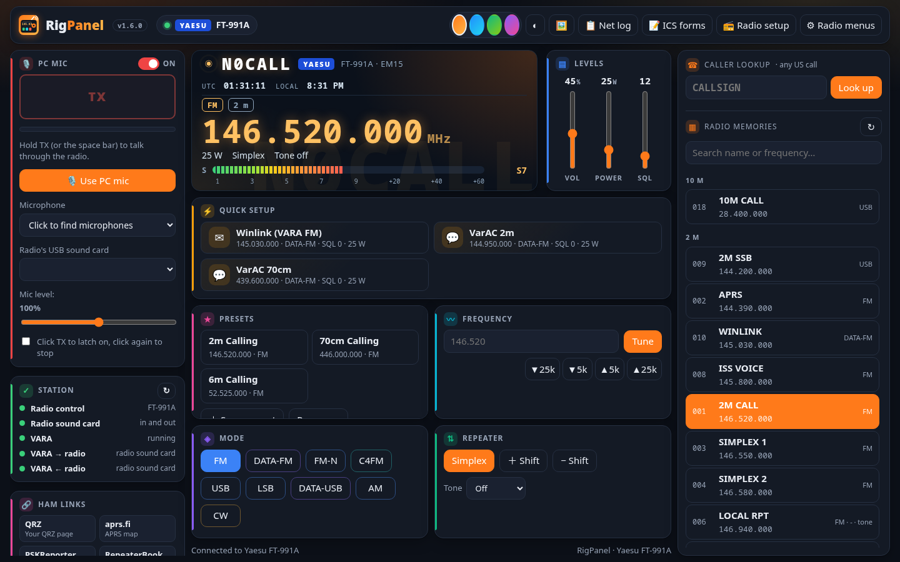

## Screenshots
| | |
|---|---|
| 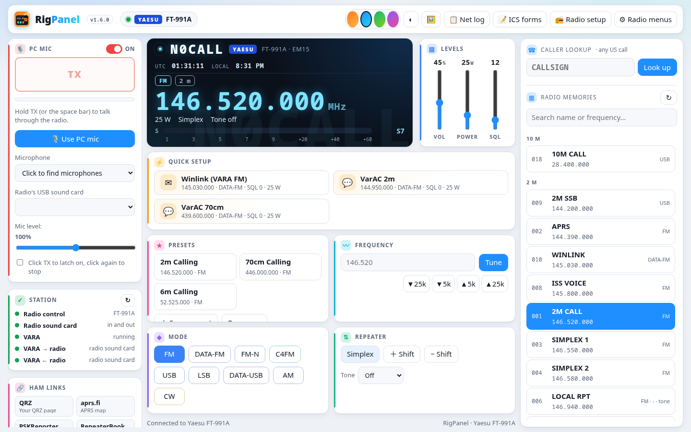 **Ocean theme, light mode** | 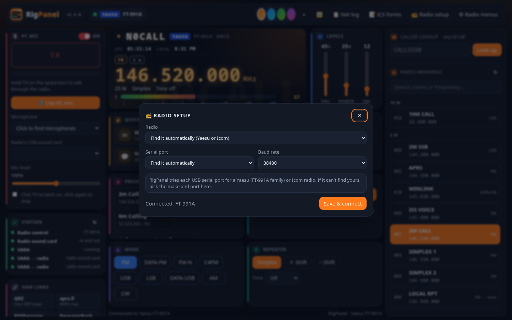 **Radio setup:** Yaesu, Icom or any Hamlib radio |
| 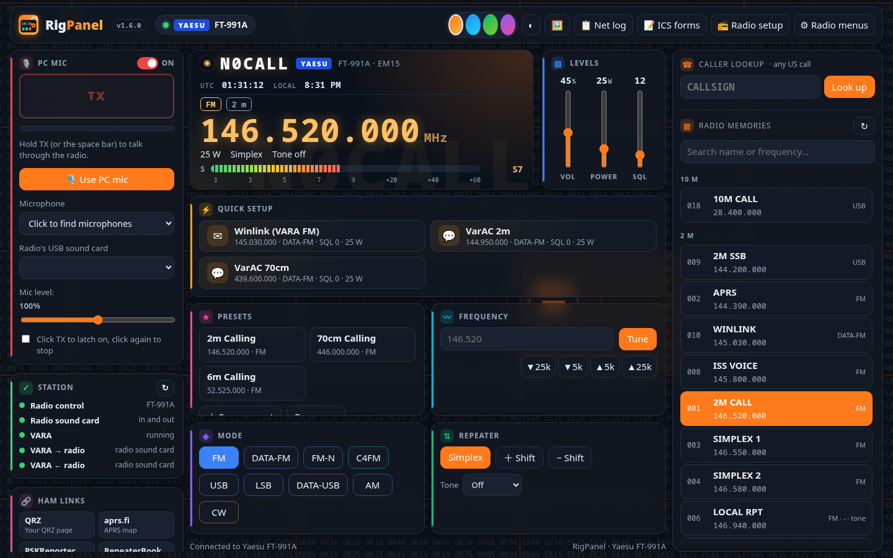 **Grid squares background**, centred on your grid square | 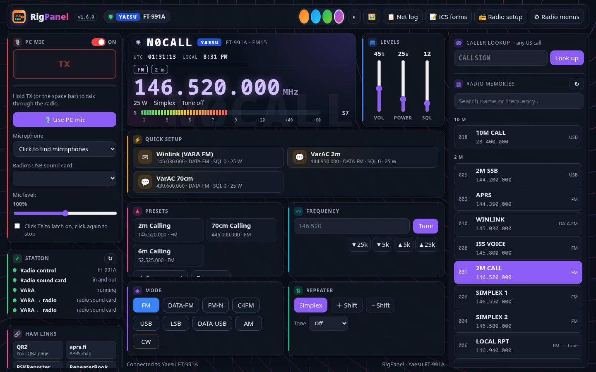 **Radio waves background**, Violet theme |
| 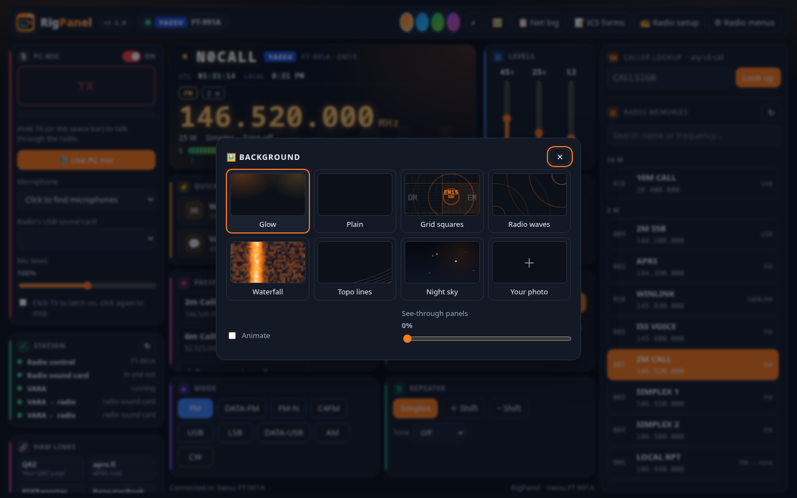 **Background picker** | 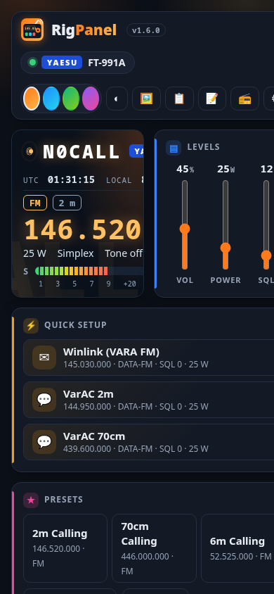 **On a phone** |
| 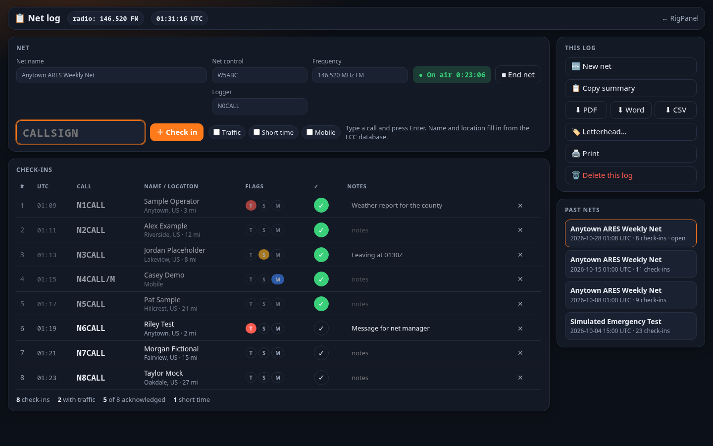 **Net log add-on** during a net | 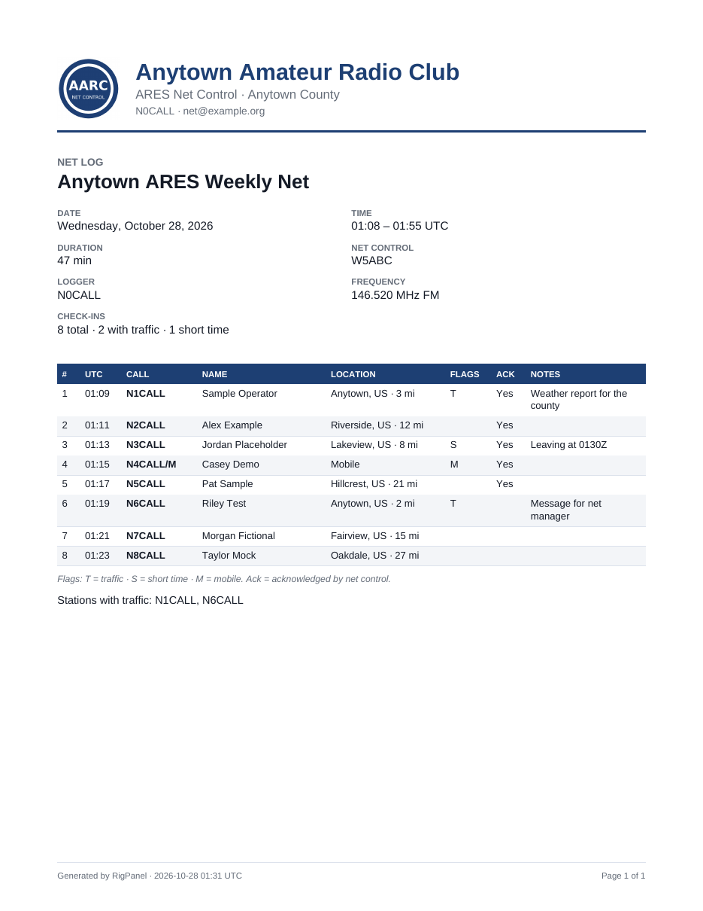 **Net log PDF export** with your letterhead |
| 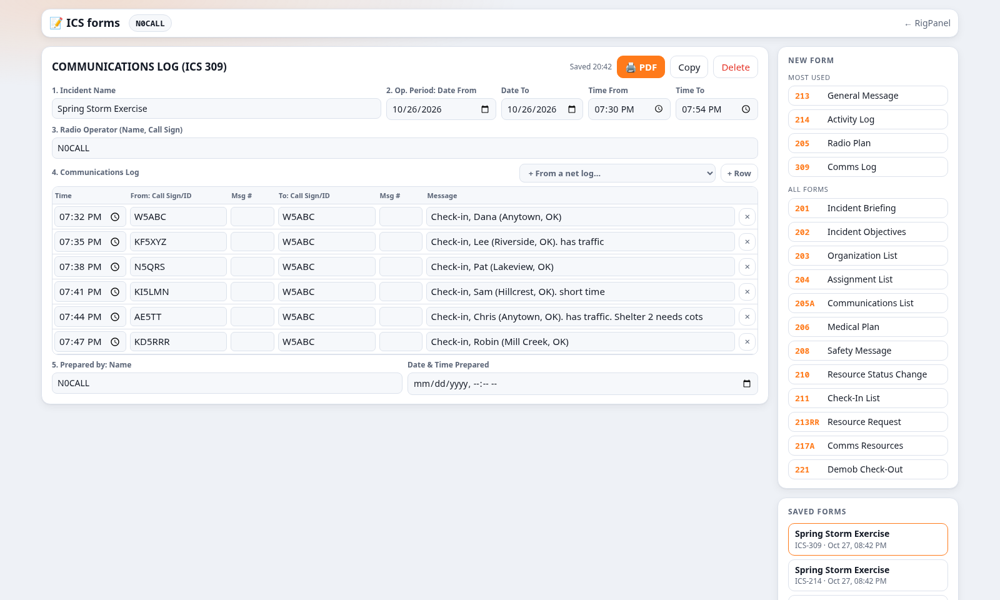 **ICS forms**: an ICS-309 filled from a net log | 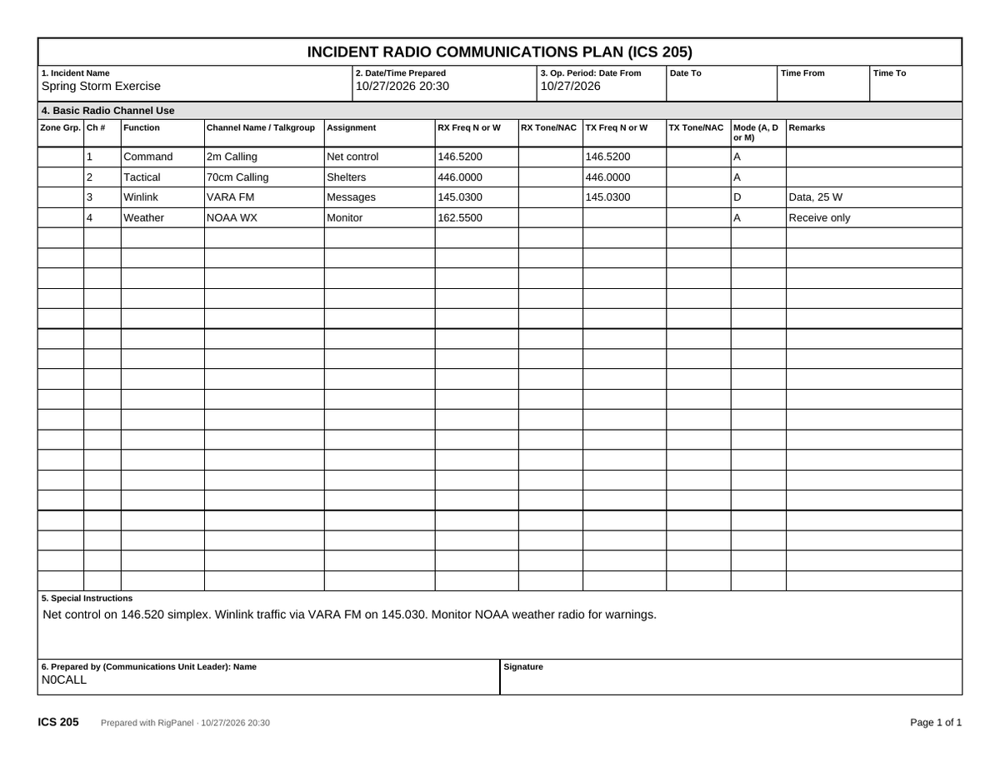 **ICS-205 PDF** with channels from your presets |

Screenshots use demo data (`docs/demo_server.py`, the fictional N0CALL and generic frequencies). Regenerate them with `docs/make-screenshots.sh`.

## Supported radios
| Radio | How | Extras |
|---|---|---|
| **Yaesu FT-991A** | built in | memory channels, all 153 MENU settings, PC mic switches the radio's mic input to USB by itself |
| Yaesu FT-991, FT-891, FT-710, FTDX10, FTDX101D/MP, FT DX 3000/1200/5000 | built in (Yaesu CAT) | FT-991: memory channels |
| **Icom IC-7300, IC-705, IC-9700**, IC-7610, IC-7100, IC-7410, IC-9100, IC-7851, IC-7200, IC-7000, IC-905 | built in (CI-V) | |
| Anything else Hamlib supports (Kenwood, Elecraft, Xiegu, older Yaesu and Icom, ...) | through Hamlib's `rigctld` | |

RigPanel finds Yaesu and Icom radios by itself: it asks each USB serial port which radio is there. For other
radios, open **📻 Radio setup** in the panel and pick yours from Hamlib's list. That needs Hamlib installed:
`sudo pacman -S hamlib` (Arch), `sudo apt install libhamlib-utils` (Debian/Ubuntu/Mint), or the
[Hamlib Windows download](https://github.com/Hamlib/Hamlib/releases).

The panel only shows controls the connected radio has: no MENU editor or memory list on radios RigPanel can't
read them from, and Quick Setups and presets outside the radio's bands are hidden.

Runs on **Linux (Arch, Debian, Ubuntu, Mint, Raspberry Pi OS)** and **Windows 10/11**.

## Install

### Linux
```
tar xzf rigpanel-1.6.0.tar.gz
cd rigpanel
./install.sh
```
The installer asks for your callsign (and fills in your grid square from the FCC database for US calls),
finds the radio's USB port and baud rate, and adds **"<CALL> Rig Panel"** to your app menu. It installs for your user
only. The only time it uses `sudo` is to add you to the serial-port group (`uucp` on Arch, `dialout` on
Debian/Ubuntu) if you aren't already in it. Log out and back in afterwards.

- Change settings: `./install.sh --reconfigure`
- Unattended: `./install.sh --yes --callsign N0CALL --grid EM25fs --port /dev/ttyUSB0`
- Remove: `./uninstall.sh` (add `--purge` to also delete settings)
- Winlink Express + VARA FM: the installer offers to set them up (or run `./install-winlink.sh` any time). They're
  Windows programs, so this installs Wine and winetricks if needed (asks for `sudo`), downloads nothing itself:
  it opens winlink.org, you download the two files, and it runs their setup in their own Wine prefix
  (`~/.wine-vara`), adds **VARA FM** and **Winlink Express** to your app menu and maps the radio's Standard port to
  COM5. Intel/AMD PCs only (not a Raspberry Pi). Allow 10-20 minutes for the .NET part Winlink Express needs.

Needs: Python 3.8+ (preinstalled on most desktops). No other packages.

### Windows
Download **`RigPanel-1.6.0-Setup.exe`** from the [releases page](https://github.com/GUAC88/RigPanel/releases) and run it.
- No Python needed: RigPanel brings its own (Python 3.14 with pyserial). Your PC's own Python is left alone.
- Installs for your Windows account only (no admin rights), to `%LOCALAPPDATA%\Programs\RigPanel`.
- Asks for your callsign and grid square, whether to include the **Net log add-on**, a Desktop shortcut, and
  whether to start RigPanel at login. Remove it in **Settings → Apps**. Your settings are kept.
- Optional **Winlink Express** and **VARA FM** (shown only if they aren't installed yet): setup opens the
  winlink.org download page, picks the files up from your Downloads folder and runs their own installers.
- The installer isn't code-signed yet, so Windows SmartScreen may say "Windows protected your PC". Click
  **More info → Run anyway**.
- Upgrading from the 1.4 zip install: run the setup. It replaces the old copy and keeps your settings.

For IT-managed installs there's **`RigPanel-1.6.0.msi`** (per-user, silent with `msiexec /i RigPanel-1.6.0.msi /qn`;
features `NetLogAddon`, `DesktopShortcut`, `StartAtLogin` via `ADDLOCAL`/`REMOVE`). It asks no questions: RigPanel
asks for your callsign the first time it opens, and doesn't offer Winlink/VARA. The script install from `rigpanel-1.6.0-windows.zip`
(`windows\Install-RigPanel.bat`) still works if you'd rather use your own Python.

If Windows shows no COM ports for the radio, install the
[Silicon Labs CP210x driver](https://www.silabs.com/developers/usb-to-uart-bridge-vcp-drivers) (Yaesu, IC-7300, IC-9700).
Yaesu radios show up as two COM ports. The panel needs the **Enhanced** one. Using Winlink? Leave the
**Standard** one for VARA FM's PTT (see [Winlink with VARA FM](#winlink-with-vara-fm)).

## Radio settings
- **Baud rate** must match the radio: Yaesu FT-991A MENU **031 CAT RATE** (default 38400); Icom **CI-V USB Baud Rate**
  (IC-7300 default 115200). Change it any time under **📻 Radio setup**.
- Icom: **CI-V USB Echo Back** can be on or off. Leave the CI-V address blank and RigPanel asks the radio for it.
- Only one program can use the CAT port reliably at a time. Point other programs at RigPanel's Hamlib server
  (below) instead of the radio.

## Backgrounds
Open **🖼** in the top bar to pick a background: **Glow**, **Plain**, **Grid squares** (centred on your own
square), **Radio waves**, **Waterfall**, **Topo lines**, **Night sky**, or **Your photo** (your shack, your
antenna...). Patterns are drawn in your colour theme and can be made stronger or fainter, and the moving
ones can be still. Photos can be darkened, blurred, fitted or tiled, and **See-through panels** lets the
background show through. The choice is saved with your settings, so every browser you use sees it.

## Talking with your PC microphone
The **PC Mic** panel sends your computer's microphone to the radio's USB sound card while you hold **TX** (or the
space bar). Pick the microphone and the radio's sound card once; the browser remembers them.
- The **On/Off switch** in the panel's header turns the PC mic off when you don't need it (for example while
  running Winlink/VARA). Off releases the microphone and the radio's sound card and disables TX; the browser
  remembers the choice.
- On the FT-991A, RigPanel switches the radio's mic input to USB while you transmit and back afterwards.
- On other radios, set the radio's mod/mic source to USB once in its menu (the panel shows where for your radio).
- The radio unkeys if the page closes, the browser stops responding, or a transmission runs past 3 minutes
  (`"ptt_timeout"` in `config.json`).

## Station status
The **Station** card under the PC mic checks every 5 seconds:

| Check | Linux | Windows |
|---|---|---|
| Radio control | the CAT connection | the CAT connection |
| Radio sound card | the radio's USB sound card has both input and output | the radio's USB sound card is installed |
| VARA | running | running |
| VARA audio | VARA's sound **actually goes to and comes from** the radio's sound card | VARA's sound card settings name the radio's USB Audio CODEC |
| VARA PTT port | | warns if VARA uses RigPanel's COM port for CAT (see below) |

On Linux, VARA runs under Wine and Wine doesn't reconnect its audio after the radio's USB drops out (radio
switched off and on, cable bumped): VARA ends up talking to the PC speakers or the headset and hearing nothing.
The card shows where it went, and **🔧 Fix VARA audio** moves it back without restarting VARA.

## Ham links
The **Ham links** card opens popular sites in a new tab. QRZ, aprs.fi and PSKReporter open straight to your own
callsign. Edit the list in `HAM_LINKS` near the end of `app/index.html`.

## Net log add-on (optional)
The installer asks whether to add the **Net log**, a logger for running net control, opened from the
**📋 Net log** button in the panel:
- Type a callsign and press Enter. Each check-in is stamped in UTC, with the name, city and distance from the FCC
  database, and the radio's frequency is filled in for you.
- Mark **Traffic**, **Short time**, **Mobile**, **✓ acknowledged** and notes on each check-in.
- **Logger** (under Net control) records who kept the log when that isn't net control.
- Export to **PDF** or **Word** with your club's letterhead (built from its name, tagline and logo, or your own
  uploaded letterhead image), to **CSV**, or **Copy summary** for posting.

Logs are saved as you go in `netlogs/` in RigPanel's settings folder. Choose without being asked with
`./install.sh --netlog` / `--no-netlog` (Windows: `-NetLog` / `-NoNetLog`).
The same logger is also available as a stand-alone app with no radio needed: see [netlog/README.md](netlog/README.md).

## ICS forms
**📝 ICS forms** opens a page with 16 standard ICS forms. The four radio operators use most are at the top:

| Form | Filled in for you |
|---|---|
| **ICS-213** General Message | From (your callsign), date and time |
| **ICS-214** Activity Log | Your name and the date. **+ Row** stamps the time on each activity |
| **ICS-205** Incident Radio Communications Plan | **+ My presets** adds your saved frequencies, with repeater offsets and tones |
| **ICS-309** Communications Log | **From a net log…** adds every check-in of a net, with its times and the logger as radio operator |

Also included: **201** Incident Briefing, **202** Incident Objectives, **203** Organization Assignment List (with its
standard positions listed), **204** Assignment List, **205A** Communications List, **206** Medical Plan, **208** Safety
Message/Plan, **210** Resource Status Change, **211** Incident Check-In List (can fill from a net log), **213RR**
Resource Request, **217A** Communications Resource Availability Worksheet (can fill from your presets) and **221**
Demobilization Check-Out. Not included: 207 (an org chart), 209, and the air operations and planning worksheets.

Forms save as you type. **🖨 PDF** gives the filled-in form in the standard layout (numbered boxes, continued on
more pages if needed) to print, file or attach to a Winlink message. **Copy** starts the next operational period
from the same form. Forms are kept in `icsforms/` in RigPanel's settings folder.

## Sharing the radio with other programs (Hamlib)
RigPanel also runs a Hamlib `rigctld`-compatible server on `localhost:4532`. Point other programs
at it instead of the radio's COM port, and they control the radio *through* RigPanel, so nothing fights
over the CAT port:
- **VarAC**: Settings → Rig control → frequency control **Hamlib (rigctld)**, host `localhost`, port `4532`.
- **WSJT-X / fldigi / others**: rig **Hamlib NET rigctl**, address `localhost:4532`.

Supported with every radio: frequency, mode (USB/LSB/CW/FM/AM/RTTY/PKTUSB/PKTFM/C4FM...), PTT, RF power,
S-meter, and starting the antenna tuner. Change the port with `"hamlib_port"` in `config.json`, or set it to `0` to turn it off.

## Winlink with VARA FM
Tap the **✉ Winlink (VARA FM)** Quick Setup to put the radio on your Winlink frequency in DATA-FM, simplex, squelch
open. Then set up VARA FM once:
- **Sound card**: the radio's USB sound card (**USB Audio CODEC** / **PCM2903B** on Yaesu) for *both* input and
  output. If VARA's input is set to anything else (a "Monitor of ..." device, the PC mic), it sends but never
  hears the other station.
- **PTT**: VARA can't key the radio through RigPanel, so give it a port RigPanel isn't using. Pick the radio's
  **Standard** COM port (the one RigPanel *doesn't* use) and **RTS**. On the FT-991A also set MENU
  **076 FM PKT PTT SELECT** to **RTS** (in RigPanel's MENU editor under *FM & packet*).
- **Windows**: a COM port can only be open in one program at a time. If VARA is set to key the radio by CAT
  on the same COM port as RigPanel (the **Enhanced** one), whichever starts second can't open it: either VARA
  can't transmit or RigPanel loses the radio. Use RTS on the Standard port as above, or VARA's **VOX** PTT.
  The Windows installer warns if it finds VARA FM set up this way.
- **Linux (VARA under Wine)**: map the Standard port to a Wine COM port, e.g.
  `ln -s /dev/serial/by-id/...-if01-port0 ~/.wine/dosdevices/com5`. If the radio is switched off and on while
  VARA is running, restart VARA so it finds the sound card again.

## How it's built
| Piece | What it does |
|---|---|
| `app/rigpanel.py` | A small Python web server (standard library only) on `localhost`: the panel's API, the Hamlib server, PC mic keying, station status. |
| `app/radios.py` | The radio drivers: Yaesu CAT and Icom CI-V over the USB serial port (termios on Linux, pyserial on Windows), and Hamlib through `rigctld`. |
| `app/index.html` | The whole user interface. One page of HTML, CSS and JavaScript with no frameworks. It polls the server once a second. |
| `app/netlogcore.py`, `app/netexport.py`, `app/index-net.html` | The Net log add-on: log storage and API, PDF/Word export with letterhead, and its page. `app/netlog.py` runs the same thing as the stand-alone Net Log app. |
| `app/icsforms.py`, `app/index-ics.html` | ICS forms: storage, API and the PDF forms (each form's layout is described once and used for both the page and the PDF), and the page. |
| `app/menus.json` | The FT-991A MENU table (001-153), built from Yaesu's CAT Operation Reference Manual, with known misprints corrected. |
| `app/nwr.json` | NOAA Weather Radio transmitters and the counties they serve, from NOAA's [County Coverage Listing](https://www.weather.gov/nwr/county_coverage) (public domain). Refresh it with `tools/update-nwr.py`. Your county comes from the FCC's [census area lookup](https://geo.fcc.gov/api/census/). |
| `app/launch.py`, `app/stop.py` | Start the app in the background and open the browser; stop it before an upgrade or uninstall (used by the Windows installers). |
| `installers/` | `build-windows.sh` builds the Windows `Setup.exe` (Inno Setup, run under Wine) and `.msi` (msitools) with Python built in. |
| `install.sh` / `windows\*.ps1` | Per-user installers: copy files, write settings, create the menu entry and auto-start. |

Your settings live in `~/.config/rigpanel/` on Linux or `%APPDATA%\RigPanel\` on Windows:
- `config.json`: callsign, grid, radio type, port, baud, web port, Winlink frequency
- `profiles.json`: Quick Setup buttons, editable
- `presets.json`, `lookups.json`
- `background`: your background photo, if you uploaded one

The panel only listens on `localhost`, so other computers on your network can't control the radio.
Callsign lookups use [callook.info](https://callook.info) (FCC data, US calls only).

## License
Copyright (C) 2026 Cody KJ5JDO. RigPanel is free software under the
[GNU General Public License v3.0 or later](LICENSE). You can use, change and share it; if you share a
modified version, it must stay under the GPL too. It comes with no warranty. You are responsible for
what your station transmits.
